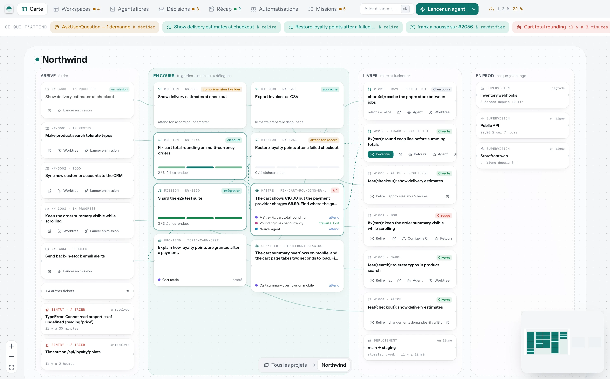
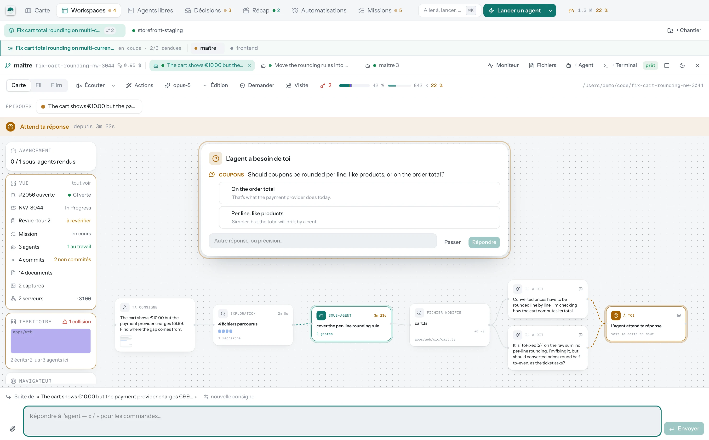
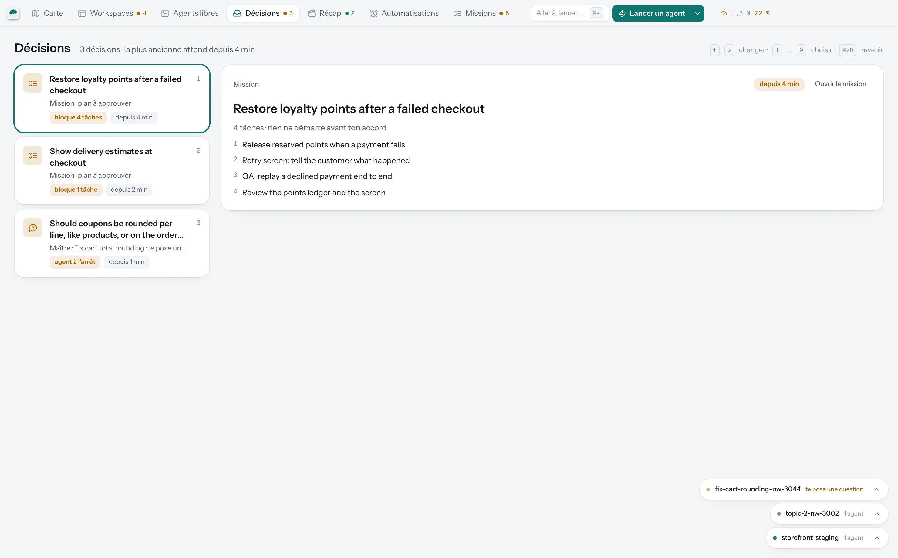
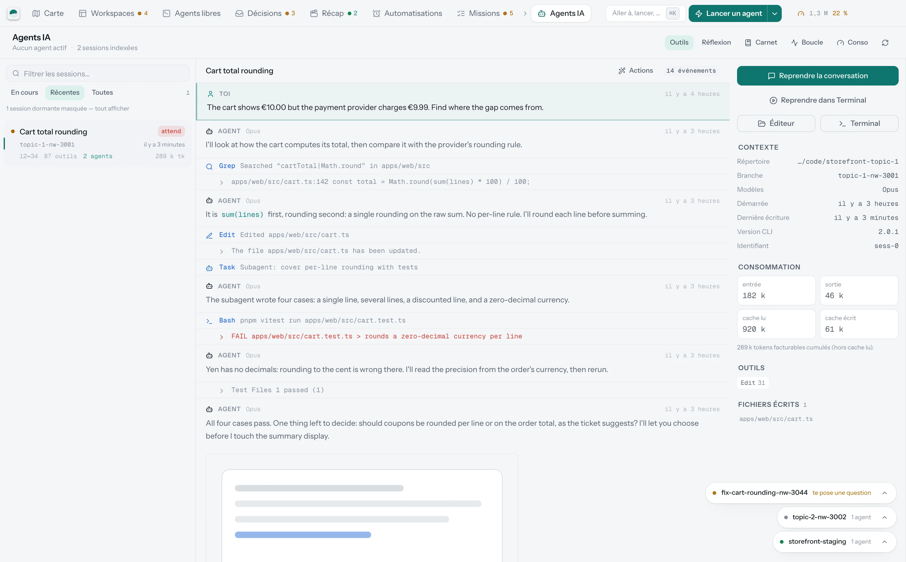

# Cockpit

Poste de pilotage macOS pour les agents de code — Claude Code, Codex, Gemini.
On lance des agents sur des worktrees, on suit ce qu'ils font, on répond quand
ils ont besoin de toi, et on relit ce qu'ils livrent, dans une seule fenêtre
native.

*A native macOS cockpit to run, watch and steer coding agents (Claude Code,
Codex, Gemini) across git worktrees. The UI and docs are in French.*

[](LICENSE)


<picture>
  <source media="(prefers-color-scheme: dark)" srcset="docs/images/carte-dark.webp">
  
</picture>

Application Tauri 2 — binaire natif, aucun serveur. Rust pour tout ce qui
touche au système (git, processus, fichiers, HTTP), React + Tailwind pour
l'interface. Rien n'est embarqué : Cockpit pilote les outils déjà installés
sur le poste (`git`, `claude`, `gh`…).

<p align="center">
  
</p>

<table>
  <tr>
    <td width="33%"></td>
    <td width="33%"></td>
    <td width="33%"></td>
  </tr>
  <tr>
    <td align="center"><sub>Un workspace : l'agent attend ta réponse</sub></td>
    <td align="center"><sub>Les décisions qui t'attendent</sub></td>
    <td align="center"><sub>Ce qu'un agent a fait, outil par outil</sub></td>
  </tr>
</table>

<sub>Captures prises en mode aperçu (`pnpm vite:dev` dans un navigateur), sur
des données d'exemple.</sub>

---

## Démarrer

```bash
pnpm install
pnpm dev          # développement, rechargement à chaud
pnpm install:app  # compile et installe Cockpit.app dans /Applications
pnpm build        # produit Cockpit.app + un .dmg dans src-tauri/target/release/bundle
```

`pnpm install:app` est la commande du quotidien : elle installe l'app dans
`/Applications`, d'où elle se lance comme n'importe quelle autre (Spotlight,
Launchpad, Dock) sans dépendre d'un terminal ouvert. Elle saute volontairement
la cible `.dmg`, dont le script de bundling attend une autorisation
d'automatisation du Finder et reste bloqué sans elle.

## Prérequis

**Le poste.** macOS 13 minimum, et macOS seulement : le cockpit parle à
`osascript`, `open`, Terminal.app et `dscl`, il n'a pas d'équivalent ailleurs.
Le shell utilisé pour tout ce qu'il lance est `zsh` — celui de macOS convient.

**Pour compiler.** Node 20+, pnpm, Rust stable (`rustup`), Xcode Command Line
Tools (`xcode-select --install`). La première compilation Rust prend plusieurs
minutes ; les suivantes sont incrémentales.

**Les outils qu'il pilote.** Rien n'est embarqué : le cockpit se sert de ce qui
est déjà installé sur le poste.

| Outil                  | Ce qu'il dessert                                          | Sans lui                                        |
| ---------------------- | --------------------------------------------------------- | ----------------------------------------------- |
| `git`                  | Worktrees, écran Git, diffs, commits                       | rien ne fonctionne                              |
| `claude`               | Écran Agents IA, lancement et reprise des missions         | plus d'agents, le reste tient                   |
| `gh` authentifié       | Repli quand aucun jeton GitHub n'est configuré             | il faut fournir `COCKPIT_GITHUB_TOKEN`          |
| `docker` ou `orb`      | Écran Infra locale, serveur ntfy de l'accès mobile, isolation des agents | la liste des conteneurs reste vide, l'isolation refuse de démarrer si activée |
| `zed`, `cursor`, `code`| Ouverture d'un fichier dans l'éditeur                      | les liens vers l'éditeur ne font rien           |
| Tailscale              | `pnpm setup:mobile` uniquement                             | pas d'accès mobile                              |

Le CLI `claude` est cherché dans le `PATH` du shell de connexion, puis dans
`~/.local/bin`, `~/.claude/local`, `/opt/homebrew/bin`, `/usr/local/bin`,
`~/.bun/bin` et `~/.volta/bin`. L'écran Agents lit `~/.claude/projects` en
lecture seule : sur un poste qui n'a jamais fait tourner Claude Code, il est
vide, et c'est normal.

**La configuration.** Un seul fichier, `~/.config/cockpit/config.toml`, écrit
par l'écran **Réglages** — personne n'a besoin de l'éditer à la main. Le strict
minimum est la section `[general]` : `projects_root`, `main_repo`, `editor`.
Toutes les intégrations SaaS sont facultatives et se rajoutent une par une ;
un bloc sans jeton laisse simplement son écran vide.

**Le catalogue de scripts.** Une installation neuve n'a aucune commande
fournie d'office : chaque projet déclare les siennes, ou les fait détecter
depuis les scripts de son dépôt (voir « Ajouter une commande au catalogue »).

## Installer sans compiler

Les versions publiées vivent sur [jodevweb/cockpit-releases](https://github.com/jodevweb/cockpit-releases/releases/latest) :
une archive `Cockpit_<version>_<arch>.app.tar.gz`, pas de `.dmg`.

```bash
tar xzf Cockpit_<version>_arm64.app.tar.gz
mv Cockpit.app /Applications/
xattr -dr com.apple.quarantine /Applications/Cockpit.app
```

L'archive est compilée pour l'architecture de la machine qui publie — en
pratique Apple Silicon. Un Mac Intel doit passer par les sources.

**La troisième ligne n'est pas facultative.** L'application est signée ad hoc et
non notarisée : sans elle, Gatekeeper refuse de l'ouvrir. Et le vieux contournement
— clic droit → Ouvrir — **a disparu depuis macOS 15** : il n'y a plus d'entrée
« Ouvrir quand même » dans le menu contextuel, seulement au fond de Réglages
Système → Confidentialité et sécurité, après une première tentative refusée.
Retirer l'attribut de quarantaine évite tout ce parcours : Gatekeeper n'évalue
alors plus l'application du tout.

Ensuite l'updater intégré prend le relais et propose les versions suivantes tout
seul — l'endpoint est public, aucun compte GitHub n'est nécessaire pour le lire.

## Publier une version

```bash
pnpm release 0.2.0 "Ce que change cette version"
```

Le script porte la version dans les trois manifestes, compile, signe l'archive
et publie une release sur le dépôt public des binaires, `latest.json` compris.
Les cockpits installés le lisent quelques fois par jour et proposent la mise à
jour ; l'installation ne part jamais sans un clic, parce qu'elle relance
l'application et arrête les agents en cours.

La clé de signature vit hors du dépôt (`~/.tauri/cockpit.key`), chiffrée par un
mot de passe rangé dans le trousseau macOS. Une archive non signée par elle est
refusée par les applications installées : c'est ce qui fait qu'un dépôt de
binaires compromis ne suffit pas à livrer n'importe quoi.

## Configuration

Un seul fichier : `~/.config/cockpit/config.toml` (permissions 600).
Tout est éditable depuis l'écran **Réglages** ; `config.example.toml` sert de
référence commentée.

Les jetons ne descendent jamais dans le webview : toutes les requêtes SaaS
partent du process Rust. L'interface ne connaît qu'un booléen « configuré ».

Chaque secret peut venir d'une variable d'environnement, qui prime sur le
fichier :

| Service      | Variable                    | Jeton attendu                                          |
| ------------ | --------------------------- | ------------------------------------------------------ |
| GitHub       | `COCKPIT_GITHUB_TOKEN`      | facultatif — repli automatique sur `gh auth token`     |
| Sentry       | `COCKPIT_SENTRY_TOKEN`      | auth token utilisateur (`project:read`, `event:write`) |
| Linear       | `COCKPIT_LINEAR_TOKEN`      | clé API personnelle                                     |
| Trigger.dev  | `COCKPIT_TRIGGER_TOKEN`     | secret key d'environnement (`tr_prod_…`, `tr_staging_…`) |
| Railway      | `COCKPIT_RAILWAY_TOKEN`     | token de compte ou de projet                            |
| Better Stack | `COCKPIT_BETTERSTACK_TOKEN` | token API Uptime                                        |
| Stripe       | `COCKPIT_STRIPE_TOKEN`      | clé restreinte en lecture seule                         |

## Les écrans

| Écran             | Ce qu'il montre                                                                                                                  |
| ----------------- | -------------------------------------------------------------------------------------------------------------------------------- |
| **Vue d'ensemble** | Agents actifs, worktrees à surveiller, erreurs Sentry, PR ouvertes, derniers documents produits.                                   |
| **Agents IA**      | Toutes les sessions Claude Code, leur timeline complète, sous-agents, outils, fichiers écrits, consommation. Reprise en un clic.   |
| **Worktrees**      | État git de chaque arbre, diff par fichier, commits, sessions rattachées, création et suppression via l'outillage du dépôt.        |
| **Git**            | Toutes les branches, ce que chacune change depuis sa divergence avec la base : arbre de fichiers, commits, graphe, diff.           |
| **Scripts**        | Commandes maison avec leurs options en formulaire, scripts du `package.json`, exécution avec sortie live et annulation.            |
| **Documents**      | Livrables des agents (`.claude/work`, `.claude/reviews`, `docs/`, markdown racine) sur tous les worktrees, rendus en markdown.     |
| **Observabilité**  | Issues Sentry (résolution et mise en sourdine depuis l'app), incidents et monitors Better Stack.                                   |
| **Delivery**       | Issues Linear, pull requests, GitHub Actions, runs Trigger.dev, déploiements Railway, événements Stripe.                           |
| **Impact**         | Tout ce qui bouge sur les dépôts déclarés — PR GitHub, MR GitLab, branches parties sans demande de fusion — et, à la demande, ce que chaque changement implique : pour le produit, pour l'équipe, et ce qui risque de casser. |
| **Infra locale**   | Conteneurs Docker et ports de développement en écoute.                                                                            |

## Raccourcis

| Touche      | Action                            |
| ----------- | --------------------------------- |
| `⌘K`        | Palette de recherche et d'actions |
| `⌘1` … `⌘9` | Écrans, dans l'ordre du menu      |
| `⌘0`        | Réglages                          |
| `⌘⇧A`       | Replier ou rappeler le panneau de travail |
| `⌘⇧I`       | Le moniteur des changements, et retour   |
| `⌘⇧T`       | Nouveau terminal sur le chantier en cours |

## Le panneau de travail

À droite de l'écran, un panneau montre **un worktree, ses agents et ses
terminaux** — pas une liste d'objets indépendants. C'est la façon dont on
travaille : on ouvre un chantier, on y lance deux agents et un `pnpm dev`, on le
met de côté pour lire une PR, on y revient entier.

Les terminaux sont de vrais shells derrière un pseudo-terminal : `⌃C` arrête ce
qui tourne, les interfaces plein écran s'affichent correctement, et le shell
reste utilisable quand la commande se termine. Fermer un onglet, et cela seul,
arrête le processus — le serveur de dev meurt avec sa descendance, pas juste
avec son shell.

Replié, le groupe descend dans le dock en bas à droite : une pastille par
worktree, qui dit ce qui tourne, ce qui attend une autorisation et ce qu'on n'a
pas lu. Un clic le rouvre sur l'onglet qu'on y regardait.

L'écran **Scripts** reste indépendant : c'est le lanceur de commandes
paramétrables, avec sa sortie en direct, sans shell interactif derrière.

## Fraîcheur des données

Aucun écran n'attend qu'on appuie sur « rafraîchir ».

Ce qui vient du disque est piloté par événement : `~/.claude/projects` et le
`.git` du dépôt principal sont surveillés par `notify`, et toute écriture
pousse un rafraîchissement (avec palier, pour absorber les rafales et ignorer
les écritures que provoquent nos propres lectures). Comme les métadonnées des
worktrees vivent sous `.git/worktrees/`, une seule surveillance les couvre tous.

Ce qui vient du réseau est sondé à intervalle : quelques secondes pour Docker et
les ports, deux à trois minutes pour les SaaS — assez pour rester juste, assez
peu pour ne pas entamer les quotas d'API.

Dans les deux cas le rythme s'arrête quand la fenêtre passe en arrière-plan et
repart par un rechargement immédiat au retour : un cockpit qu'on regarde est à
jour, un cockpit qu'on ne regarde pas ne coûte rien.

## Comment ça lit les agents

Claude Code écrit un JSONL par session sous
`~/.claude/projects/<chemin-encodé>/<session-id>.jsonl`, plus un dossier
`<session-id>/subagents/` pour les sous-agents. Le cockpit lit ces fichiers
**en lecture seule** et surveille l'arborescence via `notify` : dès qu'un agent
écrit, la vue se rafraîchit (avec un debounce de 1,5 s pour absorber les
rafales).

Le rattachement session ↔ worktree se fait sur le champ `cwd` des entrées, pas
sur le nom de dossier encodé : c'est fiable même quand une branche contient des
tirets.

Une session est considérée **active** si son journal a bougé dans les trois
dernières minutes, **récente** en deçà d'une heure, **dormante** au-delà.

## Ce qu'un agent a le droit de consommer

Deux garde-fous, dans **Réglages → Missions**, pour deux formes de la même
peur : la machine qui sature.

**Le coupe-circuit mémoire** (`memoryCeilingPercent`, 85 % par défaut) refuse
de démarrer un agent de plus tant que la mémoire de la machine dépasse le
seuil — mission, exécutant ou lancement manuel confondus. Chaque agent tient
plusieurs process (le CLI, ses ponts MCP) ; sans lui, rien n'empêchait d'en
cumuler assez pour saturer le poste.

**L'isolation par conteneurs** (section « Isolation des agents », éteinte par
défaut) va plus loin : chaque agent tourne dans un conteneur avec sa propre
mémoire plafonnée par le système, imposée plutôt que mesurée après coup. Elle
couvre ce que le coupe-circuit ne voit pas — un agent qui lance lui-même un
`pnpm dev` ou un build lourd via son propre outil Bash. Demande Docker ou
OrbStack sur le poste (repli automatique sur `orb` puis `docker`, ou un
runtime déclaré explicitement) ; l'image par défaut se construit une fois,
à la main :

```bash
docker build -t cockpit-agent:latest sandbox/
```

Le worktree est monté au même chemin à l'intérieur qu'à l'extérieur du
conteneur, et les identifiants (`~/.claude`, `~/.gitconfig`, `~/.ssh`) en
lecture seule. Activée sans runtime installé, le lancement de l'agent est
refusé avec un message clair plutôt que de retomber en direct sans le dire.

## Architecture

```
src-tauri/src/
  config.rs        config TOML + variables d'environnement, vue expurgée pour l'UI
  git.rs           worktrees, statut porcelain v2, diffs, commits
  sessions.rs      parsing des JSONL Claude Code (résumés + timelines + sous-agents)
  protocol.rs      les trois façons de parler à un agent, derrière une seule valeur
  executions.rs    ce que chaque agent a fait : identité, tours, coûts, timeline
  docs.rs          découverte des livrables markdown
  runner.rs        exécution de commandes, streaming ligne à ligne, groupes de processus
  system.rs        éditeur, Terminal.app, Finder, Docker, ports
  integrations.rs  Sentry, Better Stack, Linear, GitHub, Trigger, Railway, Stripe
  monitor.rs       recensement des changements en vol, toutes forges confondues
  impact.rs        dossier factuel d'un changement, lecture par agent, relecture du rapport
  lib.rs           commandes IPC + surveillance du système de fichiers

src/
  app/             shell, menu, palette ⌘K, état global
  views/           un fichier par écran
  components/      système de composants, markdown, logs ANSI, diff, flux SaaS
  lib/             types miroir, IPC typée, formatage, catalogue de commandes
```

## Ajouter une commande au catalogue

Les commandes se déclarent par projet, depuis l'écran Scripts ou dans la
configuration (`src-tauri/src/commands.rs`). Une entrée décrit une commande, son
argument positionnel et ses options ; l'interface construit le formulaire et la
ligne de commande toute seule. Le format, tel qu'il s'écrit en TOML :

```toml
[[commands]]
id = "worktree-create"
group = "Worktrees"
label = "Créer un worktree"
description = "git worktree + .env + install."
base = "pnpm worktree:create"
scoped = false

[commands.positional]
label = "Branche"
placeholder = "feat/ma-feature"
required = true

[[commands.options]]
id = "from"
flag = "--from"
label = "Partir de"
kind = "text"
```

## Moteurs d'agents : Claude Code, Codex et Gemini

Un moteur (Réglages → Moteurs d'agents) déclare un protocole. Trois sont
câblés :

- **`claude-stream-json`** (le défaut) — un process qui reste ouvert d'un tour
  à l'autre.
- **`codex-exec`** — OpenAI Codex CLI (`codex exec`). À l'opposé : chaque tour
  relance un process (`codex exec resume <fil>` pour les suivants), qui se
  termine de lui-même une fois la réponse rendue. Le cockpit traduit ce qu'il
  peut vers la forme que le fil de discussion sait déjà lire — texte de
  l'agent, commande lancée, fin de tour — et laisse le reste de côté plutôt
  que d'afficher un champ deviné (voir `codex.rs`).
- **`gemini-stream-json`** — Google Gemini CLI (`gemini --output-format
  stream-json`). Un seul tour possible : aucune source ne documente de
  mécanisme de reprise pour ce mode (voir `gemini.rs`), donc un agent Gemini
  ne reçoit qu'un message et s'arrête là. Traduction la plus prudente des
  trois — le schéma des événements vient d'une pull request qui a livré la
  fonctionnalité, pas d'une documentation stabilisée : deux pages officielles
  se contredisaient sur son existence même au moment où ceci a été écrit.

`codex-exec` et `gemini-stream-json` ne peuvent pas encore être le moteur
d'une mission (maître ou exécutant) : les outils de mission et le pont
d'autorisation sont des mécanismes du protocole par défaut.

Leur historique, en revanche, se relit désormais. Le cockpit tient son propre
relevé de ce que font les agents (`executions.rs`), écrit au fil de l'eau et
valable pour les trois moteurs : l'écran Agents s'y replie quand il n'y a pas
de journal Claude Code à lire. Un historique Codex reste incomplet par
construction — ni son raisonnement ni les sorties de ses commandes n'ont de
forme vérifiée — et le relevé le dit plutôt que de le combler.

## Limites connues

- **macOS uniquement.** Le cockpit s'appuie sur `osascript`, `open`,
  Terminal.app et le trousseau ; aucun portage Linux ou Windows n'est prévu.
- **Cursor** n'expose pas ses conversations en fichiers lisibles (SQLite interne) :
  seuls ses livrables écrits sur disque apparaissent, dans l'écran Documents.
- **Codex et Gemini** (`codex-exec`, `gemini-stream-json`) n'ont pas été
  vérifiés contre leur vrai binaire, absent de tout poste où ces protocoles
  ont été écrits — seulement contre leur documentation officielle et un faux
  CLI de test qui en imite le comportement. Gemini avec moins de certitude que
  Codex : sa documentation était contradictoire d'une page à l'autre au
  moment où ceci a été écrit. Voir « Moteurs d'agents » ci-dessus.

## Contribuer

Les issues et pull requests sont les bienvenues. Pour une faille de sécurité,
passe par le signalement privé décrit dans [SECURITY.md](SECURITY.md), pas par
une issue publique.

## Licence

[MIT](LICENSE)
