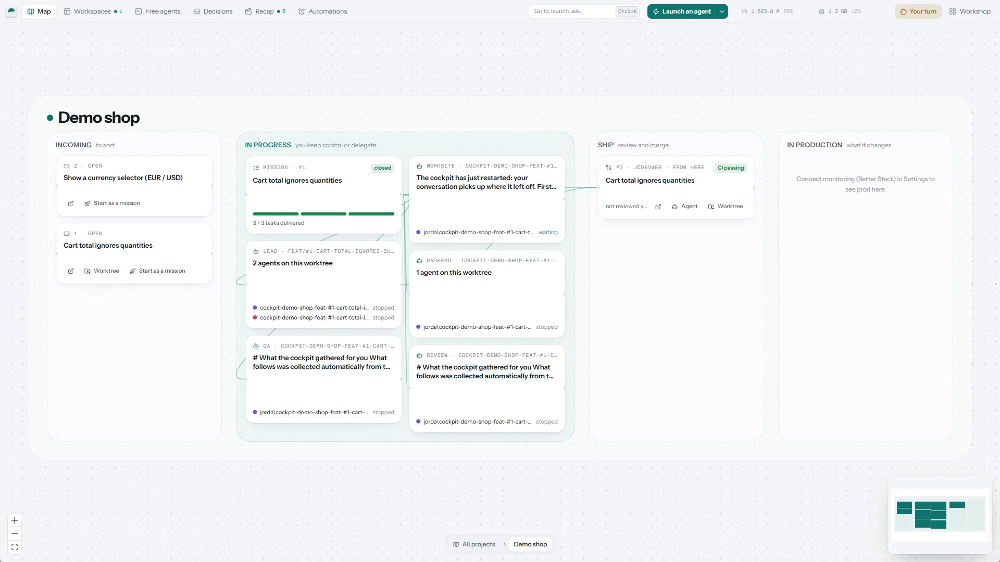
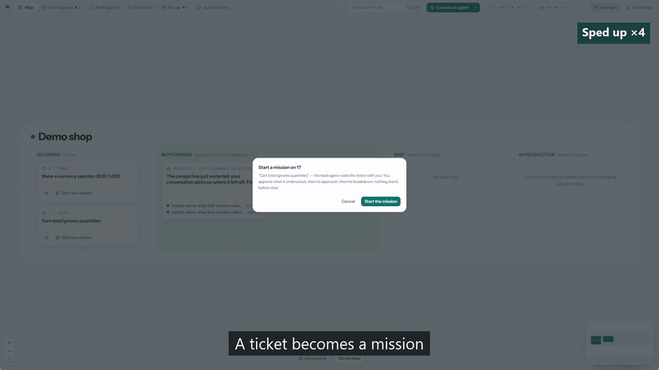
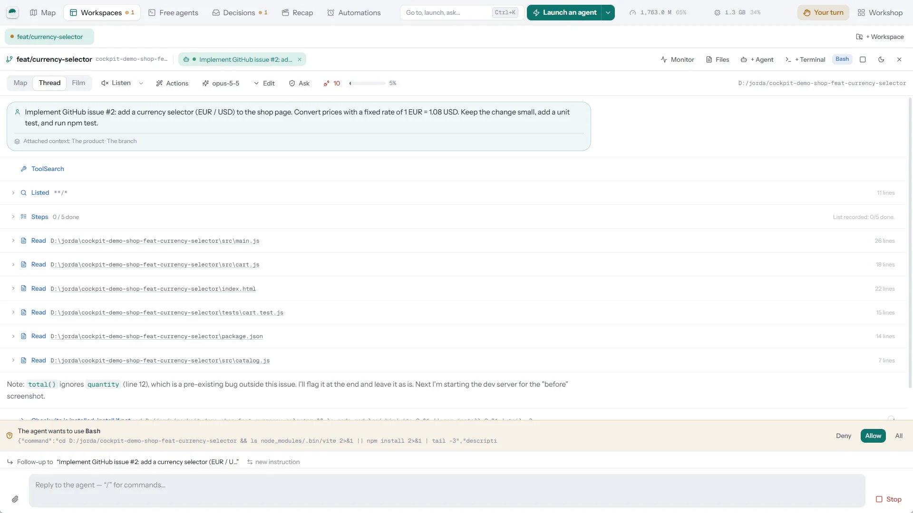
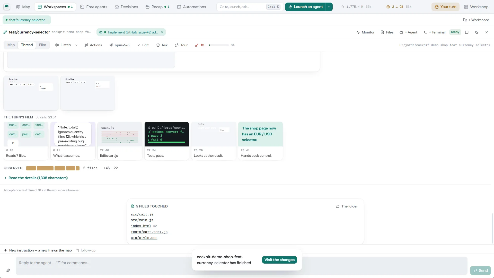
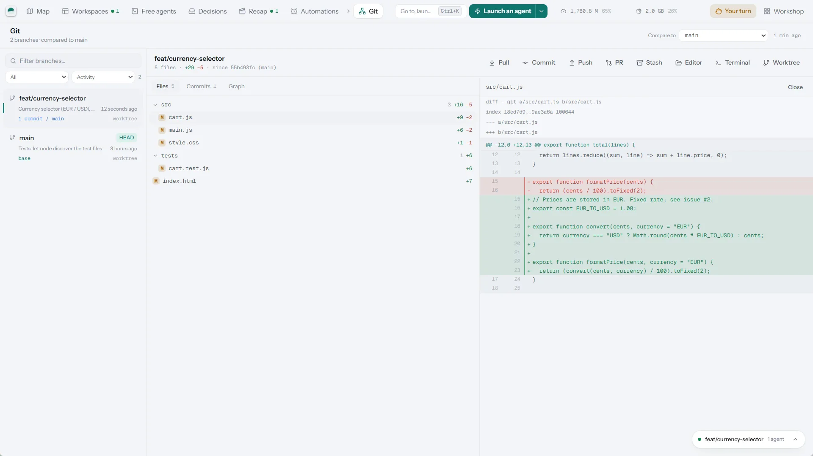
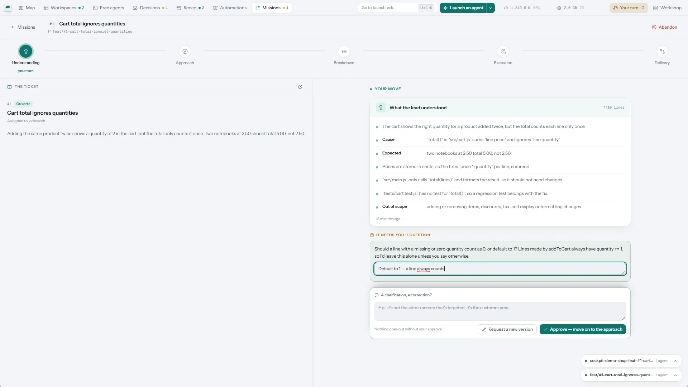
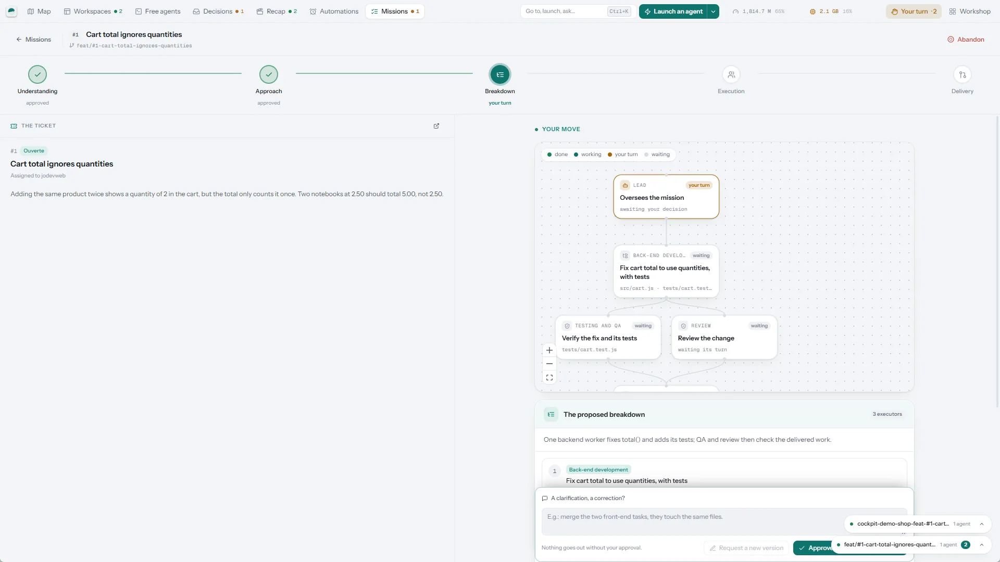
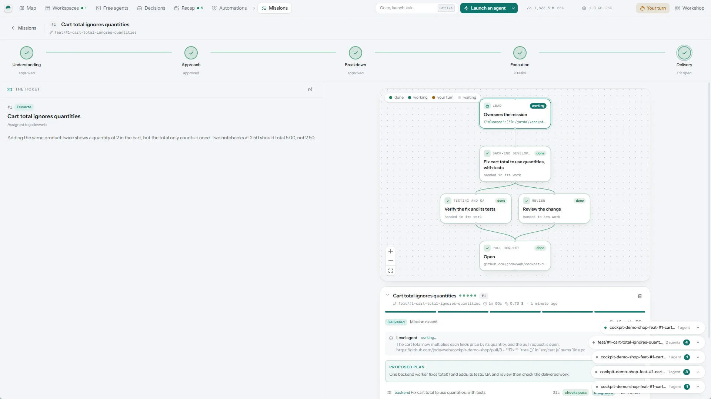

# Cockpit

*English · [Français](README.fr.md)*

A cockpit for coding agents — Claude Code, Codex, Gemini — on macOS,
Windows and Linux. Launch agents on worktrees, follow what they do, answer when they
need you, and review what they deliver, all in one native window.

[](LICENSE)




A Tauri 2 application — a native binary, no server. Rust for everything that
touches the system (git, processes, files, HTTP), React + Tailwind for the
interface. Nothing is bundled: Cockpit drives the tools already installed on
the machine (`git`, `claude`, `gh`…).

## Why Cockpit

Plenty of tools run agents in parallel on worktrees. Cockpit takes care of
what comes next: **being able to trust what they deliver without reading all
of it**.

- **You see before.** The exact context the agent will receive (the brief),
  and a plan split into tasks that nothing launches without your approval.
- **You check without reading 800 lines.** Repository checks that must pass
  before anything is integrated, properties replayed against the repository's
  past fixes to prove they can fail, a video of what the agent did in its
  browser, and a tour of the changes taken from git rather than from what the
  agent says about them.
- **It learns from your corrections.** What you fix by hand after an agent
  becomes, once you approve it, a lesson the next agents receive for those
  files.
- **Nothing happens behind your back.** A log of what was done on your behalf,
  guardrails that hold even without permission prompts (write scope, git
  operations forbidden to workers), and orphan processes found and stopped.
- **Local and open.** MIT license, no server: tokens and code stay on your
  machine.

<p align="center">
  
</p>

<table>
  <tr>
    <td width="33%"></td>
    <td width="33%"></td>
    <td width="33%"></td>
  </tr>
  <tr>
    <td align="center"><sub>A workspace: the agent asks before running a command</sub></td>
    <td align="center"><sub>The film of its turn: what it read, changed and tested</sub></td>
    <td align="center"><sub>The branch and its diff, without leaving Cockpit</sub></td>
  </tr>
  <tr>
    <td width="33%"></td>
    <td width="33%"></td>
    <td width="33%"></td>
  </tr>
  <tr>
    <td align="center"><sub>A mission: you confirm what the lead agent understood</sub></td>
    <td align="center"><sub>Then its breakdown, before anything starts</sub></td>
    <td align="center"><sub>Delivered: a pull request and its dossier</sub></td>
  </tr>
</table>

<sub>Screenshots taken from a real session: a new JavaScript web project, two
GitHub issues, one handled in a workspace, the other as a mission. In the GIF,
waits are sped up, and it says so.</sub>

---

## Getting started

```bash
pnpm install
pnpm dev          # development, hot reload
pnpm install:app  # builds and installs the app on this machine
pnpm build        # macOS: Cockpit.app + .dmg; Windows: NSIS installer
                  # (in src-tauri/target/release/bundle)
```

`pnpm install:app` is the everyday command. On macOS it installs the app in
`/Applications`, from where it launches like any other (Spotlight, Launchpad,
Dock) without depending on an open terminal; it deliberately skips the `.dmg`
target, whose bundling script waits for a Finder automation permission and
hangs without it. On Windows it builds the NSIS installer and runs it
silently: the app is installed for the current user (`%LOCALAPPDATA%\Cockpit`),
without administrator rights, and shows up in the Start menu.

`pnpm install:app` and `pnpm setup:mobile` go through `scripts/plateforme.mjs`,
which picks the variant for the system: the `.sh` on macOS, the `.ps1` on
Windows when there is one (otherwise the `.sh`, run by Git for Windows' bash).

## Requirements

**The machine.** macOS 13 or later, Windows 10 (21H2 and later) / 11 on x64,
or Linux on x64 (see "Linux"). The shell used for everything the cockpit
launches is `zsh` on macOS — the system one is fine —, `bash` on Linux, and
**Git for Windows**' bash on Windows (see below).

**To build.** Node 20+, pnpm, stable Rust (`rustup`). On macOS, the Xcode
Command Line Tools (`xcode-select --install`). On Windows, Rust's MSVC
toolchain (`rustup default stable-x86_64-pc-windows-msvc`, the default one),
the **Visual Studio Build Tools** with the "Desktop development with C++"
workload (MSVC compiler and Windows SDK), and **Strawberry Perl**
(`winget install StrawberryPerl.StrawberryPerl`) to build OpenSSL: Git for
Windows' Perl lacks some of the modules it needs. If `perl` still points to
Git's, set the right one with
`set OPENSSL_SRC_PERL=C:\Strawberry\perl\bin\perl.exe`. The first Rust build
takes several minutes; the next ones are incremental.

**The tools it drives.** Nothing is bundled: the cockpit uses what is already
installed on the machine.

| Tool                   | What it serves                                             | Without it                                      |
| ---------------------- | ---------------------------------------------------------- | ----------------------------------------------- |
| `git`                  | Worktrees, Git screen, diffs, commits                       | nothing works                                   |
| `claude`               | AI Agents screen, launching and resuming missions           | no more agents, the rest still works            |
| authenticated `gh`     | Fallback when no GitHub token is configured                 | `COCKPIT_GITHUB_TOKEN` must be provided         |
| `docker` or `orb`      | Local Infra screen, ntfy server for mobile access, agent isolation | the container list stays empty, isolation refuses to start when enabled |
| `zed`, `cursor`, `code`| Opening a file in the editor                                | editor links do nothing                         |
| Tailscale              | `pnpm setup:mobile` only                                    | no mobile access                                |

The `claude` CLI is looked up in the login shell's `PATH` (Git Bash on
Windows), then, on macOS, in `~/.local/bin`, `~/.claude/local`,
`/opt/homebrew/bin`, `/usr/local/bin`, `~/.bun/bin` and `~/.volta/bin`. The
Agents screen reads `~/.claude/projects` read-only: on a machine that has never
run Claude Code, it is empty, and that is expected.

**Configuration.** A single file, `~/.config/cockpit/config.toml`, written by
the **Settings** screen — nobody needs to edit it by hand. The bare minimum is
the `[general]` section: `projects_root`, `main_repo`, `editor`. Every SaaS
integration is optional and can be added one at a time; a block without a
token simply leaves its screen empty.

**The script catalog.** A fresh install ships no commands: each project
declares its own, or has them detected from its repository's scripts (see
"Adding a command to the catalog").

## Installing without building (macOS)

Published versions live on [jodevweb/cockpit-releases](https://github.com/jodevweb/cockpit-releases/releases/latest):
one `Cockpit_<version>_<arch>.app.tar.gz` archive per Mac architecture, no
`.dmg` (for Windows, see the "Windows" section below).

```bash
tar xzf Cockpit_<version>_aarch64.app.tar.gz
mv Cockpit.app /Applications/
xattr -dr com.apple.quarantine /Applications/Cockpit.app
```

Versions are built by GitHub Actions for Apple Silicon (`aarch64`) and, when
cross-compilation succeeds, for Intel Macs (`x64`). A version without an `x64`
archive is not offered to Intel Macs: they go through the sources instead.

**The third line is not optional.** The application is signed with a
self-signed (or ad hoc) identity and is not notarized: without that line,
Gatekeeper refuses to open it. And the old workaround — right-click → Open —
**is gone since macOS 15**: there is no "Open anyway" entry in the context menu
anymore, only deep in System Settings → Privacy & Security, after a first
refused attempt. Removing the quarantine attribute avoids all of that:
Gatekeeper then does not evaluate the application at all.

After that, the built-in updater takes over and offers the next versions on
its own — the endpoint is public, no GitHub account is needed to read it.

## Linux

**Machine requirements.** x64, a desktop with WebKitGTK 4.1 (Ubuntu 22.04,
Debian 12, Fedora 38 and later have it), `git`, `bash`, and Claude Code
installed and signed in. Docker is optional, as elsewhere.

**Installing from the release.** Versions published on
[jodevweb/cockpit-releases](https://github.com/jodevweb/cockpit-releases/releases/latest)
include a `Cockpit_<version>_amd64.AppImage` and a `.deb`.

```bash
chmod +x Cockpit_<version>_amd64.AppImage
./Cockpit_<version>_amd64.AppImage          # or: sudo apt install ./Cockpit_<version>_amd64.deb
```

The built-in updater replaces the AppImage with the next versions; a `.deb`
is updated by installing the next one.

**Building.** Besides Node, pnpm and Rust, the WebKitGTK development
packages — on Debian and Ubuntu:

```bash
sudo apt install libwebkit2gtk-4.1-dev libgtk-3-dev libayatana-appindicator3-dev librsvg2-dev libxdo-dev libssl-dev libasound2-dev
pnpm install
pnpm install:app   # builds the AppImage, installs it in ~/.local/bin, adds a menu entry
```

**What differs.** Files and links open with `xdg-open`; a terminal opens in the
first one installed among `x-terminal-emulator`, GNOME Terminal, Konsole, Xfce
Terminal, kitty, Alacritty, WezTerm, foot and xterm. Listening ports come from
`ss`, processes and memory from `/proc`.

## Windows

**Machine requirements.**

- **Windows 10 (21H2+) or 11**, x64.
- **[Git for Windows](https://git-scm.com/download/win), required.** The
  cockpit runs all its commands — catalog scripts, agent launches, `git`
  itself — in Git for Windows' bash, like Claude Code on Windows. It finds it
  from `git` in the `PATH`, then in `Program Files\Git` and
  `%LOCALAPPDATA%\Programs\Git`; the `COCKPIT_BASH` variable forces another
  path to `bash.exe`. The `bash.exe` in `System32` (WSL) is never used.
- **WebView2**, already present on Windows 11 and on an up-to-date
  Windows 10. If it is missing, the installer downloads and installs it.
- **Claude Code** installed and authenticated (`claude` reachable from Git
  Bash), as on Mac. The other tools in the table above (`gh`, Docker Desktop,
  an editor…) remain optional.

**Installing from the release.** Versions published on
[jodevweb/cockpit-releases](https://github.com/jodevweb/cockpit-releases/releases/latest)
include a `Cockpit_<version>_x64-setup.exe` installer. It installs the cockpit
for the current user, without administrator rights, and adds it to the Start
menu. The built-in updater then offers the next versions, as on Mac: the
installation starts with one click and restarts the app.

**SmartScreen.** The installer is not Authenticode-signed: on first launch,
Windows shows "Windows protected your PC". Click **More info**, then **Run
anyway**. If the browser blocks the download itself, choose **Keep** in its
download list. You can also unblock the file before running it: right-click →
Properties → check **Unblock**, or in PowerShell
`Unblock-File .\Cockpit_<version>_x64-setup.exe`.

**Building.** With the build requirements above, from PowerShell or Git Bash:

```powershell
pnpm install
pnpm install:app   # builds the NSIS installer and installs it
```

**What differs from the Mac.**

- Shortcuts use `Ctrl` where the Mac uses `⌘` (`Ctrl+K` for the palette,
  etc.); in a terminal, only shortcuts with `Shift` stay with the app,
  `Ctrl`+letter belongs to the shell.
- The window keeps Windows' native title bar.
- What goes through Finder, Terminal.app or `open` on macOS goes through
  Explorer and Windows file associations.
- Mobile access is set up with `pnpm setup:mobile`, which runs
  `scripts/setup-mobile.ps1`: Tailscale for Windows and Docker Desktop are
  required.
- No code signing: nothing like macOS permissions is asked again from one
  version to the next, but SmartScreen warns on each manual installation (not
  on built-in updates).

## Configuration

A single file: `~/.config/cockpit/config.toml` (permissions 600). Everything
can be edited from the **Settings** screen; `config.example.toml` is the
commented reference.

Tokens never go down to the webview: every SaaS request leaves from the Rust
process. The interface only knows a "configured" boolean.

Each secret can come from an environment variable, which takes precedence over
the file:

| Service      | Variable                    | Expected token                                         |
| ------------ | --------------------------- | ------------------------------------------------------ |
| GitHub       | `COCKPIT_GITHUB_TOKEN`      | optional — automatic fallback to `gh auth token`        |
| Sentry       | `COCKPIT_SENTRY_TOKEN`      | user auth token (`project:read`, `event:write`)         |
| Linear       | `COCKPIT_LINEAR_TOKEN`      | personal API key                                        |
| Trigger.dev  | `COCKPIT_TRIGGER_TOKEN`     | environment secret key (`tr_prod_…`, `tr_staging_…`)    |
| Railway      | `COCKPIT_RAILWAY_TOKEN`     | account or project token                                |
| Better Stack | `COCKPIT_BETTERSTACK_TOKEN` | Uptime API token                                        |
| Stripe       | `COCKPIT_STRIPE_TOKEN`      | read-only restricted key                                |

## Screens

The top bar holds the screens you use all day; the others are in the
**Workshop** drawer, on the right of the bar.

| Screen            | What it shows                                                                                                                    |
| ----------------- | -------------------------------------------------------------------------------------------------------------------------------- |
| **Map**           | Each project as four columns — incoming, in progress, ship, in production — with its tickets, missions, workspaces and pull requests, and the "Waiting on you" bar above (a cross sets an item aside until it changes). |
| **Workspaces**    | A worktree, its agents and its terminals, side by side (see "The work panel").                                                    |
| **Free agents**   | Agents launched outside any project, in a folder of your choice.                                                                  |
| **Decisions**     | Everything waiting for your answer: permissions, questions, plans to approve.                                                     |
| **Recap**         | What happened over the past hour, three hours or day, told visually.                                                              |
| **Missions**      | One ticket, one plan, several workers: you confirm what the lead agent understood, its approach, its breakdown; each worker gets its own branch and worktree; repository checks gate every delivery; the pull request carries a delivery dossier. |
| *Workshop*        | **Today**, **Permanence** (an agent on call, within hours and budgets you set), **AI agents** (every Claude Code session, its timeline, its tools), **Documents**, **Flow** (tickets, PRs, CI, deployments), **Impact** (what each change in flight implies), **Observability** (Sentry, Better Stack), **Worktrees**, **Git**, **Scripts**, **Servers & containers**, **Settings**. |

## Shortcuts

| Key         | Action                                 |
| ----------- | -------------------------------------- |
| `⌘K`        | Search and action palette              |
| `⌘1` … `⌘9` | Screens, in menu order                 |
| `⌘0`        | Settings                               |
| `⌘⇧A`       | Fold or recall the work panel          |
| `⌘⇧I`       | The change monitor, and back           |
| `⌘⇧T`       | New terminal on the current workspace  |

## The work panel

On the right of the screen, a panel shows **a worktree, its agents and its
terminals** — not a list of independent objects. That is how work actually
happens: you open a workspace, launch two agents and a `pnpm dev` in it, set it
aside to read a PR, and come back to it whole.

Terminals are real shells behind a pseudo-terminal: `⌃C` stops what is
running, full-screen interfaces display correctly, and the shell stays usable
when the command ends. Closing a tab, and only that, stops the process — the
dev server dies with its descendants, not just with its shell.

Folded, the group goes down into the dock at the bottom right: one badge per
worktree, saying what is running, what is waiting for a permission and what
you haven't read. A click reopens it on the tab you were looking at.

The **Scripts** screen stays independent: it is the parameterized command
launcher, with its live output, without an interactive shell behind it.

## Data freshness

No screen waits for you to press "refresh".

What comes from disk is event-driven: `~/.claude/projects` and the main
repository's `.git` are watched by `notify`, and every write triggers a refresh
(with a delay, to absorb bursts and ignore the writes our own reads cause).
Since worktree metadata lives under `.git/worktrees/`, a single watch covers
them all.

What comes from the network is polled: every few seconds for Docker and ports,
every two to three minutes for SaaS — enough to stay accurate, little enough
not to eat into API quotas.

In both cases the rhythm stops when the window goes to the background and
resumes with an immediate reload when it comes back: a cockpit you look at is
up to date, a cockpit you don't look at costs nothing.

## How it reads agents

Claude Code writes one JSONL per session under
`~/.claude/projects/<encoded-path>/<session-id>.jsonl`, plus a
`<session-id>/subagents/` folder for subagents. The cockpit reads these files
**read-only** and watches the tree with `notify`: as soon as an agent writes,
the view refreshes (with a 1.5 s debounce to absorb bursts).

Sessions are matched to worktrees on the entries' `cwd` field, not on the
encoded folder name: it is reliable even when a branch contains dashes.

A session is considered **active** if its log moved in the last three minutes,
**recent** under an hour, **dormant** beyond that.

## What an agent is allowed to consume

Two guardrails, in **Settings → Agents**, for two forms of the same fear: the
machine running out.

**The memory circuit breaker** (`memoryCeilingPercent`, 85 % by default)
refuses to start one more agent while the machine's memory is above the
threshold — mission, worker or manual launch alike. Each agent holds several
processes (the CLI, its MCP bridges); without it, nothing prevented stacking
enough of them to saturate the machine.

**Container isolation** ("Agent isolation" section, off by default) goes
further: each agent runs in a container with its own memory capped by the
system, enforced rather than measured after the fact. It covers what the
circuit breaker doesn't see — an agent that launches a `pnpm dev` or a heavy
build itself through its own Bash tool. It needs Docker or OrbStack on the
machine (automatic fallback to `orb` then `docker`, or an explicitly declared
runtime); the default image is built once, by hand:

```bash
docker build -t cockpit-agent:latest sandbox/
```

The worktree is mounted at the same path inside and outside the container, and
credentials (`~/.claude`, `~/.gitconfig`, `~/.ssh`) read-only. When isolation
is enabled without a runtime installed, the agent launch is refused with a
clear message rather than silently falling back to a direct launch.

A repository can version its roles in `.cockpit/roles.toml`, with the same fields
as `[[roles]]` in the config. They apply over the machine's roles, matched by `id`.
`permissionMode` and `engine` stay on the machine, and a file that sets them is
refused when the master starts: cloning a repository must not be enough to run its
agents without guardrails. A role only the repository knows starts in `acceptEdits`;
to change that, declare the same `id` in your config.

While isolation is off, the plan approval screen names the roles that will run
in `bypassPermissions` directly on the machine: their Bash tool then has the
session's rights, and the write scope only covers file edits.

Isolated or not, mission workers get a git guardrail: a `PreToolUse` hook of
the CLI (`src-tauri/src/guard.rs`, passed with `--settings`, which adds to the
repository's hooks without replacing them) refuses force-pushes, pushes to the
integration branch, its base or the project's `base_branches`, and branch
creation. It holds in `bypassPermissions`. `cargo run --example guard` checks
the hook command as the machine's shell will read it.

## Architecture

```
src-tauri/src/
  config.rs        TOML config + environment variables, redacted view for the UI
  git.rs           worktrees, porcelain v2 status, diffs, commits
  sessions.rs      parsing of Claude Code JSONL (summaries + timelines + subagents)
  protocol.rs      the three ways to talk to an agent, behind a single value
  executions.rs    what each agent did: identity, turns, costs, timeline
  docs.rs          discovery of markdown deliverables
  runner.rs        command execution, line-by-line streaming, process groups
  system.rs        editor, terminal, Finder/Explorer, Docker, ports
  integrations.rs  Sentry, Better Stack, Linear, GitHub, Trigger, Railway, Stripe
  monitor.rs       census of in-flight changes, across all forges
  impact.rs        factual file of a change, reading by an agent, report review
  lib.rs           IPC commands + file system watching

src/
  app/             shell, menu, ⌘K palette, global state
  views/           one file per screen
  components/      component system, markdown, ANSI logs, diff, SaaS feeds
  lib/             mirror types, typed IPC, formatting, command catalog
```

## Adding a command to the catalog

Commands are declared per project, from the Scripts screen or in the
configuration (`src-tauri/src/commands.rs`). An entry describes a command, its
positional argument and its options; the interface builds the form and the
command line by itself. The format, as written in TOML:

```toml
[[commands]]
id = "worktree-create"
group = "Worktrees"
label = "Create a worktree"
description = "git worktree + .env + install."
base = "pnpm worktree:create"
scoped = false

[commands.positional]
label = "Branch"
placeholder = "feat/my-feature"
required = true

[[commands.options]]
id = "from"
flag = "--from"
label = "Start from"
kind = "text"
```

## Agent engines: Claude Code, Codex and Gemini

An engine (Settings → Agents → Agent engines) declares a protocol. Three are
wired:

- **`claude-stream-json`** (the default) — a process that stays open from one
  turn to the next.
- **`codex-exec`** — OpenAI Codex CLI (`codex exec`). The opposite: each turn
  relaunches a process (`codex exec resume <thread>` for the following ones),
  which ends by itself once the answer is given. The cockpit translates what it
  can into the shape the conversation thread already knows how to read — agent
  text, commands, MCP tools, file changes, end of turn — and leaves the rest
  aside rather than showing a guessed field (see `codex.rs`).
- **`gemini-stream-json`** — Google Gemini CLI (`gemini --output-format
  stream-json`). A single turn only: no source documents a resume mechanism for
  this mode (see `gemini.rs`), so a Gemini agent receives one message and stops
  there. The most cautious translation of the three — the event schema comes
  from the pull request that shipped the feature, not from stable
  documentation: two official pages contradicted each other on its very
  existence when this was written.

`codex-exec` can be the engine of a mission (master or worker), outside a
container. A role's permission mode applies as it does with Claude Code:
`bypassPermissions` runs Codex without its sandbox, and the other modes run it
in its own sandbox, where a worktree cannot commit. Team slash commands are
passed as plain text, since Codex does not resolve them.
`gemini-stream-json` cannot yet be the engine of a mission.

Their history, on the other hand, can now be read back. The cockpit keeps its
own record of what agents do (`executions.rs`), written as it happens and valid
for all three engines: the Agents screen falls back to it when there is no
Claude Code log to read. A Codex history remains incomplete by construction —
its reasoning has no verified shape — and the record says so rather than
filling the gap.

## Known limitations

- **Linux is new.** It is built and tested by CI like the other systems,
  but has had less real use. System speech (`say`) has no Linux counterpart
  yet: reading aloud fails with a message there.
- On Windows, Git for Windows is required: without its bash, the cockpit opens
  but launches nothing.
- **Windows**: the installer is not Authenticode-signed (SmartScreen warning,
  see "Windows").
- **Cursor** does not expose its conversations as readable files (internal
  SQLite): only its deliverables written to disk show up, in the Documents
  screen.
- **Codex** (`codex-exec`) was checked against codex-cli 0.167 on Windows only.
  **Gemini** (`gemini-stream-json`) has not been checked against
  its real binary, only against its documentation and a fake test CLI. See
  "Agent engines" above.

## Languages

The interface, the mobile page and the cockpit's messages exist in English,
French, Spanish, German, Portuguese (Brazil), Simplified Chinese, Japanese,
Korean, Russian and Italian. By default, Cockpit follows the system language;
you change it in **Settings → Workstation → Language**. Agents answer in the
chosen language: their instructions are written in English, with a language
directive.

English is the reference. The catalogs live in `src/locales/<language>/`
(interface, through i18next) and `src-tauri/locales/<language>/` (texts
produced by Rust and the mobile page). To fix a translation or add a language:
copy the `en` files, translate the values without touching the keys or the
`{{variables}}`, declare the language in `src/i18n/index.ts` and
`src-tauri/src/i18n.rs`, then check:

```bash
node scripts/i18n-check.mjs <language>
```

The translations were produced with the help of a language model: reviews by
native speakers are welcome.

## Contributing

Issues and pull requests are welcome: start with
[CONTRIBUTING.md](CONTRIBUTING.md) (running it, checks, conventions); CI checks every pull request on macOS and
Windows (types, translation catalogs, Rust tests) and the interface in a browser
(`pnpm test:ui`, Playwright on the preview data; run
`pnpm exec playwright install chromium` once beforehand). The source code and its
comments are written in French. For a security vulnerability, use the private
report described in [SECURITY.md](SECURITY.md), not a public issue. Publishing
a version is reserved for the maintainer: see
[docs/RELEASING.md](docs/RELEASING.md).

## License

[MIT](LICENSE)
